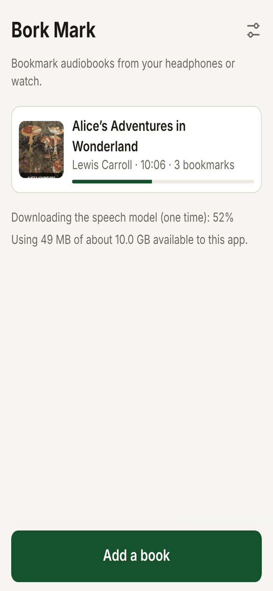
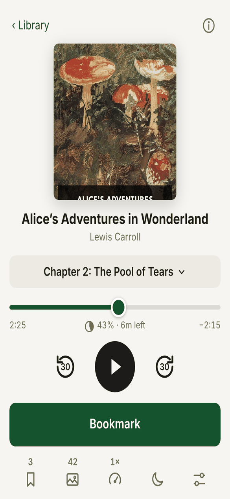
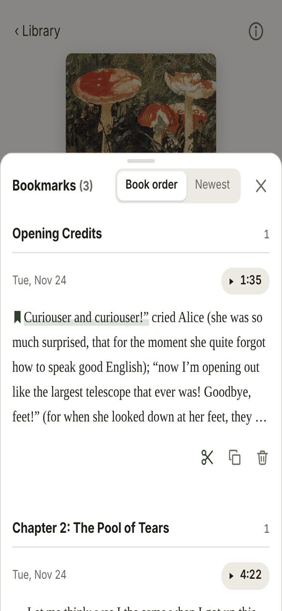
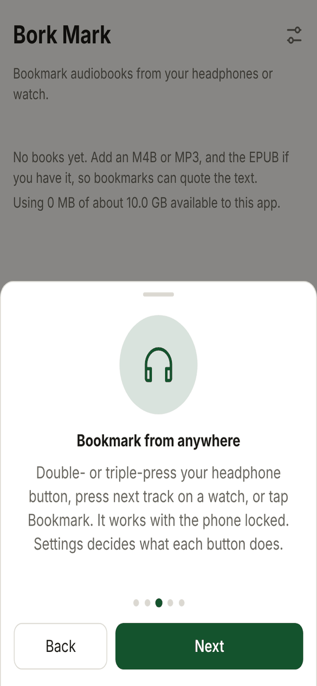
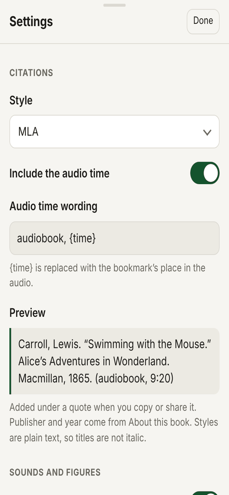
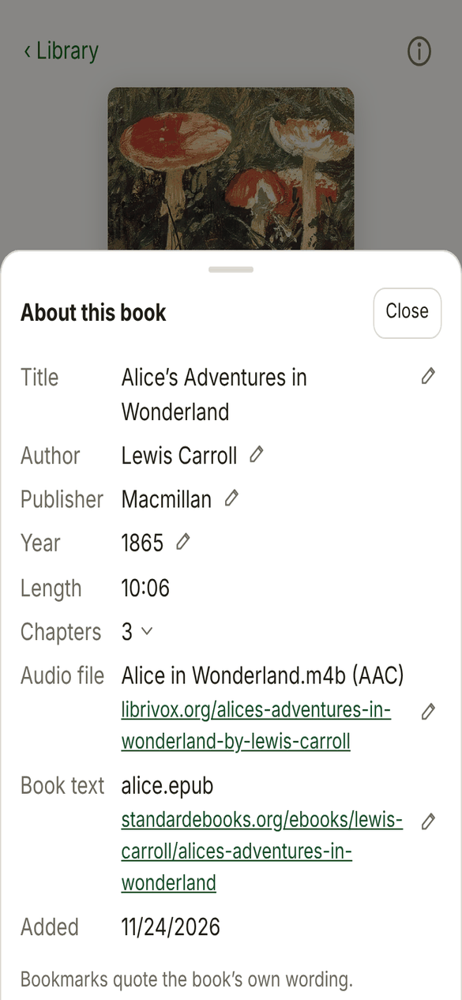

# Bork Mark

Bookmark audiobooks from your headphones or watch, and get the passage back as text.

Press a button while you listen and Bork Mark saves the place. It then finds the words you just heard in the book's text, so each bookmark becomes a quote you can trim, cite and share. It runs entirely in the browser: your books never leave the device.

**Open it:** https://jdavis-codes.github.io/bork-mark/

<p>
  
  
  
  
</p>

## Getting started

1. Open the link above in Safari on your iPhone. Tap Share, then **Add to Home Screen**, so iOS keeps your books stored and the app opens full screen.
2. Tap **Add a book** and pick the audio file (M4B or MP3). Add the EPUB too if you have it, and a PDF of the print edition if you want printed page numbers.
3. Press play. To bookmark, double- or triple-press your headphone button, press next track on a watch, or tap **Bookmark**. It works with the phone locked.
4. Open **Bookmarks** to read, trim, copy or share your quotes.

Files must be free of copy protection, such as the downloads from Libro.fm. A short guide covers the same steps the first time you open the app; Settings can show it again.

<p>
  
</p>

## What it does

| | |
|---|---|
| **Hands-free bookmarks** | The next and previous track buttons on headphones, watches and the lock screen can each bookmark, skip, or change chapter. |
| **Exact quotes** | A small speech model (Whisper, running on the phone) listens to the seconds around a bookmark, and the app finds those words in the EPUB. Without an EPUB you get what the model heard. |
| **Trimming** | Tap a sentence, drag the handles, or press and hold to cut a quote down. Ends can snap to whole sentences. |
| **Citations** | Quotes are copied and shared with a citation in a simple style, MLA, APA or Chicago, with or without the place in the audio. |
| **Page numbers** | Taken from the EPUB when it records them, or found in a PDF of the print edition. |
| **Figures** | Pictures and tables in the book text are listed, and the app can chime when the reading reaches one. |
| **Player** | Chapters, speed, sleep timer, skip buttons, a mini player, and your choice of accent colour. |

<p>
  
  
</p>

### Citations

Choose the style under Settings, Citations. The preview there shows your latest bookmark in that style.

| Style | Example |
|---|---|
| Simple | Lewis Carroll, Alice’s Adventures in Wonderland, “The Pool of Tears”, p. 21 (audiobook, 4:22) |
| MLA | Carroll, Lewis. Alice’s Adventures in Wonderland. Macmillan, 1865, p. 21. (audiobook, 4:22) |
| APA | Carroll, L. (1865). Alice’s Adventures in Wonderland (p. 21). Macmillan. (audiobook, 4:22) |
| Chicago | Lewis Carroll, Alice’s Adventures in Wonderland (Macmillan, 1865), 21. (audiobook, 4:22) |

The audio time can be turned off or reworded, for example `Libro.fm audiobook at {time}`. When a bookmark has no page number, the chapter is used instead. Citations are plain text, so titles are not italic.

Title, author, publisher and year are read from the EPUB and can be corrected under **About this book** (the ⓘ button in the player). An EPUB's date is usually that edition's, so check the year. Each file there can also carry a link, such as where you bought it.

## Good to know

- Everything is stored in the browser on your device. Removing the app from the Home Screen removes its books and bookmarks.
- The speech model is about 40 MB and is downloaded once, the first time you add a book.
- Built for Safari on iOS. It also runs in desktop Chrome and Safari.
- Quotes are found while the app is on screen. Finding them with the phone locked is an experimental setting.

## Development

There is no build step: the app is plain HTML, CSS and JavaScript modules.

```sh
python3 -m http.server 8765   # then open http://localhost:8765/
```

| File | What it holds |
|---|---|
| `index.html` | Markup and styles |
| `app.js` | The interface: library, player, bookmarks, settings |
| `align.js` | Reading M4B, MP3, EPUB and PDF files, and matching audio to text |
| `cite.js` | Citation styles |
| `align-worker.js` | The speech model, in a worker |
| `store-worker.js` | Saving files to the browser's private storage |
| `sw.js` | Service worker, so the app opens without signal |
| `buttons.html`, `align.html` | Test pages for media buttons and for alignment |

### Deploying

The app is served by GitHub Pages from the `gh-pages` branch. Before pushing a new version, run `./stamp.sh`: it writes a build number into `app.js` and `version.json`, which is how an installed copy notices that a newer version is available.
