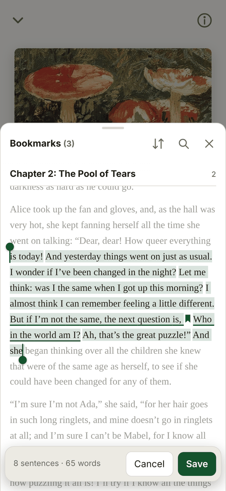
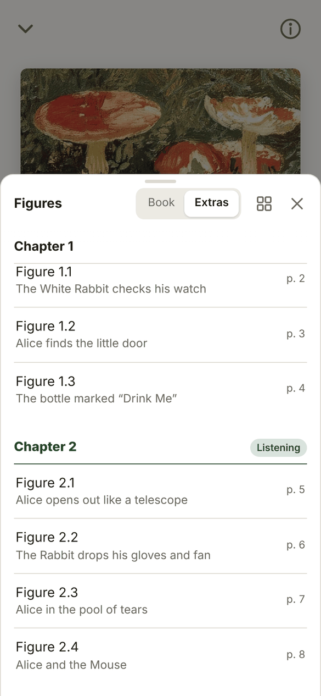

# Bork Mark

Bookmark audiobooks from your headphones or watch, and get the passage back as text.

Press a button while you listen and Bork Mark saves the place. It then finds the words you just heard in the book's text, so each bookmark becomes a quote you can trim, cite and share. It runs entirely in the browser: your books never leave the device.

**Open it:** https://jdavis-codes.github.io/bork-mark/

<table>
  <tr>
    <td width="25%"></td>
    <td width="25%"></td>
    <td width="25%"></td>
    <td width="25%"></td>
  </tr>
  <tr>
    <td><b>Listen.</b> One big button, or the one on your headphones.</td>
    <td><b>Get the words back.</b> Each bookmark becomes the passage, in the book’s own wording.</td>
    <td><b>Keep what matters.</b> Drag to the sentences you want, then copy or share with a citation.</td>
    <td><b>See what you’re hearing.</b> The figures that came with the audiobook, by chapter.</td>
  </tr>
</table>

## Getting started

1. Open the link above in Safari on your iPhone. Tap **•••**, then **Share**, then **Add to Home Screen** (it may be under View More). This matters: Safari clears a website's saved files after about a week without a visit, and only an app on the Home Screen is exempt. Without it, your books and bookmarks can disappear.
2. Tap **Add a book** and pick the audio file (M4B, M4A or MP3). Add the EPUB too if you have it, a PDF of the print edition if you want printed page numbers, and the extras PDF if the audiobook came with one.
3. Press play. To bookmark, double- or triple-press your headphone button, press next track on a watch, or tap **Bookmark**. It works with the phone locked.
4. Open **Bookmarks** to read, trim, copy or share your quotes.

Files must be free of copy protection, such as the downloads from Libro.fm. A short guide covers the same steps the first time you open the app; Settings can show it again.

## What it does

| | |
|---|---|
| **Hands-free bookmarks** | The next and previous track buttons on headphones, watches and the lock screen can each bookmark, skip, or change chapter. |
| **Exact quotes** | A small speech model (Whisper, running on the phone) listens to the seconds around a bookmark, and the app finds those words in the EPUB. Without an EPUB you get what the model heard. |
| **Trimming** | Tap a sentence, drag the handles, or press and hold to cut a quote down. Ends can snap to whole sentences. |
| **Markdown** | A Markdown file can be the book's text, with its headings as the contents. Bookmarks export as a Markdown file that reads well on its own, and another device can import that file for the same book. |
| **Citations** | Quotes are copied and shared with a citation in a simple style, MLA, APA or Chicago, with or without the place in the audio. |
| **Page numbers** | Taken from the EPUB when it records them, or found in a PDF of the print edition. |
| **Search** | Search the book's text: each result shows its chapter and two lines, opens to its paragraph, and can play from there or become a bookmark. Recent searches are kept per book. The bookmarks list can be searched too, and also shows bookmarks related by meaning: “boat” finds a quote about a canoe. |
| **Figures** | Pictures and tables in the book text, listed by chapter or as a grid, and the app can chime when the reading reaches one. |
| **Extras** | The PDF of figures, tables or notes that comes with many audiobooks sits under the same Figures button: by chapter, starting at the one you are listening to, or every page as a grid. |
| **Player** | Chapters, speed, sleep timer, skip buttons, a mini player, your choice of accent colour, and confirmation sounds in four styles with their own loudness. |

### Citations

Choose the style under Settings, Citations. The preview there shows your latest bookmark in that style.

| Style | Example |
|---|---|
| Simple | Lewis Carroll, Alice’s Adventures in Wonderland, “The Pool of Tears”, p. 21 (audiobook, 4:22) |
| MLA | Carroll, Lewis. Alice’s Adventures in Wonderland. Macmillan, 1865, p. 21. (audiobook, 4:22) |
| APA | Carroll, L. (1865). Alice’s Adventures in Wonderland (p. 21). Macmillan. (audiobook, 4:22) |
| Chicago | Lewis Carroll, Alice’s Adventures in Wonderland (Macmillan, 1865), 21. (audiobook, 4:22) |

The audio time can be turned off or reworded, for example `Libro.fm audiobook at {time}`. When a bookmark has no page number, the chapter is used instead. Citations are plain text, so titles are not italic.

Title, author, publisher and year are read from the EPUB and can be corrected under **About this book** (the ⓘ button in the player). An EPUB's date is usually that edition's, so check the year. Each file there can also carry a link, such as where you bought it.

## Good to know

- Everything is stored in the browser on your device. Removing the app from the Home Screen removes its books and bookmarks.
- The speech model is about 40 MB and is downloaded once, the first time you add a book.
- Built for Safari on iOS. It also runs in desktop Chrome and Safari.
- Quotes are found while the app is on screen. Finding them with the phone locked is an experimental setting.

## Development

There is no build step: the app is plain HTML, CSS and JavaScript modules.

```sh
python3 -m http.server 8765   # then open http://localhost:8765/
```

| Where | What it holds |
|---|---|
| `index.html` | Markup and styles |
| `app.js` | Starts the app: loads the modules below, then what runs at launch |
| `js/text/` | The book text, whatever file it came from: the word index used to find heard words (`book.js`), cutting quotes and sentences (`quote.js`), tidying tables and wrapped lines (`cleanup.js`) |
| `js/sources/` | Readers that turn a file into the book text and its contents, pages and figures: EPUB, Markdown, plain text, PDF page scans, and the extras PDF. `index.js` describes the shape they all return |
| `js/audio/` | Reading M4B and MP3 files and cutting clips (`container.js`), and decoding and transcribing a clip (`listen.js`) |
| `js/ui/` | Shared interface pieces: DOM helpers, sheets and the swipe-down gesture, scrolling titles |
| `js/*.js` | One module per part of the app: `library`, `add-book`, `player`, `screens` (moving between library and player), `marks`, `trim`, `queue` and `quotes` (finding quotes), `speech`, `figures`, `extras`, `viewer`, `info`, `book-files`, `settings-sheet`, `updates`, `intro` and so on. Each starts with a line saying what it holds |
| `js/version.js` | The version and build number, written by `stamp.sh` |
| `js/speech-worker.js` | The speech model, in a worker |
| `js/store-worker.js` | Saving files to the browser's private storage |
| `sw.js` | Service worker, so the app opens without signal. Its list of app files needs updating when a module is added |
| `buttons.html`, `tests.html` | Test pages: media buttons; alignment and which audio formats the browser plays |

### Tests

`tests/run.sh quick` checks the everyday paths in headless Chromium in about a minute; `tests/run.sh` with `lint`, `full`, `speech` or `compare <git ref>` runs less or more. CLAUDE.md says which to run when. The test media is built into `tests/fixtures/` on the first run (needs ffmpeg and python3).

### Versions and deploying

Publishing is done by a GitHub Actions workflow, `.github/workflows/deploy.yml`. Pages must be set to deploy from Actions: Settings, Pages, Source: **GitHub Actions**.

| Branch | Goes to | Also |
|---|---|---|
| `main` | https://jdavis-codes.github.io/bork-mark/ | a git tag and a GitHub release |
| `develop` | https://jdavis-codes.github.io/bork-mark/dev/ | |

Pages serves one site per repository, so every run publishes both copies together: the latest release at the top and the head of `develop` under `dev/`. A push to `develop` republishes the latest release unchanged.

The `VERSION` file holds the first two numbers, such as `0.2`. Every push to `main` gets the next free third number (`v0.2.0`, `v0.2.1`, …) as its tag and release. To start a new series, change `VERSION` to `0.2` or `1.0`. Development builds are named after the release they lead to, with a count of changes since the last release: after `v0.1.3`, the eighth change on `develop` is `0.1.4-dev.8`. Settings, App shows which version is running and the commit it was built from, linked to GitHub.

The development copy keeps its own books and settings, separate from the released app, and installs as "Bork Mark (dev)".

The workflow runs `./stamp.sh`, which writes the version, a build number and the commit into `js/version.js` and `version.json`; an installed copy compares build numbers to notice a newer version.
